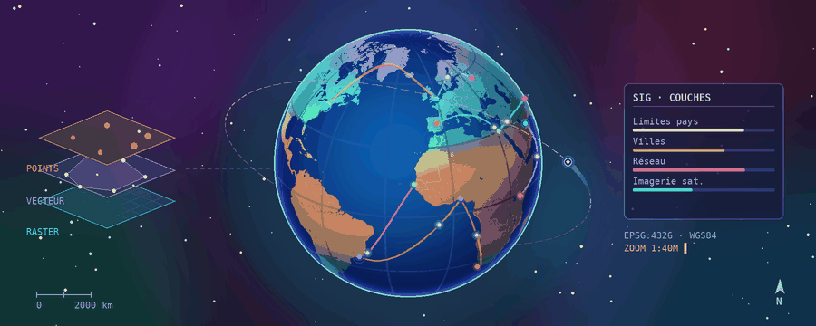

<p align="center">

</p>

<p align="center">
<a href="https://readme-typing-svg.demolab.com/"></a>
</p>

## 🧭 From Data to Decisions

I turn satellite imagery, field surveys, and multi-criteria models into interactive maps and decision-support tools that answer one question: **where**. Where to site a treatment plant. Where risk concentrates. Where a city still has room to grow.

State Engineer in Geoinformation, FSTT (2023–2026). I just wrapped up my PFE internship at Orange Morocco, building WebGIS & geomarketing tools. I like owning the full pipeline myself: data collection (satellite, field, census), processing (QGIS, GEE, Python), spatial analysis (AHP, overlay, statistics), and WebGIS delivery (Leaflet, React, APIs) that ends in a dashboard someone actually uses to make a decision.

```yaml
profile:
  name: "Leila LHANNAOUI"
  title: "GIS & Geomatics Engineer"
  based_in: "Morocco 🇲🇦"
  education: "State Engineer in Geoinformation — FSTT, Faculty of Science and Technology, Tangier (2023-2026)"

  focus:
    - "WebGIS platforms & spatial decision-support tools"
    - "Geomarketing & location intelligence"
    - "Remote sensing & Earth observation"
    - "Multi-criteria spatial analysis (AHP)"
    - "3D modeling, Digital Twin & CIM"
    - "Topography & geodesy"

  languages: ["Arabic (native)", "French (fluent)", "English (C1)"]
  status: "🟢 Open to GIS, WebGIS & remote-sensing roles"
```

---

## 🛠️ Technical Arsenal

### 🗺️ GIS & Spatial Analysis

<div align="center">
<table>
<tr><td align="center" valign="top" width="110"><br/><sub><b>QGIS</b></sub></td><td align="center" valign="top" width="110"><br/><sub><b>ArcGIS Pro</b></sub></td><td align="center" valign="top" width="110"><br/><sub><b>PhilCarto</b></sub></td><td align="center" valign="top" width="110"><br/><sub><b>Spatial Analysis</b></sub></td><td align="center" valign="top" width="110"><br/><sub><b>AHP</b></sub></td><td align="center" valign="top" width="110"><br/><sub><b>Cartography</b></sub></td></tr>
</table>
</div>

**Core Capabilities:**

* 🧭 **Desktop GIS:** QGIS, ArcGIS Pro, PhilCarto
* ⚖️ **Decision Analysis:** AHP multi-criteria analysis, site suitability, overlay analysis
* 🔌 **Plugin Development:** Custom QGIS plugins for scoring, compliance checks & eligibility analysis
* 🗺️ **Cartographic Production:** Thematic & decision-support maps in QGIS / ArcGIS Pro

### 🛰️ Remote Sensing & Earth Observation

<div align="center">
<table>
<tr><td align="center" valign="top" width="110"><br/><sub><b>Earth Engine</b></sub></td><td align="center" valign="top" width="110"><br/><sub><b>ENVI</b></sub></td><td align="center" valign="top" width="110"><br/><sub><b>Erdas Imagine</b></sub></td><td align="center" valign="top" width="110"><br/><sub><b>ESA SNAP</b></sub></td><td align="center" valign="top" width="110"><br/><sub><b>CloudCompare</b></sub></td><td align="center" valign="top" width="110"><br/><sub><b>Photogrammetry</b></sub></td><td align="center" valign="top" width="110"><br/><sub><b>Deep Learning</b></sub></td></tr>
</table>
</div>

**Earth Observation:**

* 🌍 **Cloud Platforms:** Google Earth Engine
* 🖼️ **Image Processing:** ENVI, Erdas Imagine, ESA SNAP
* 📡 **Radar & LiDAR:** InSAR processing (ESA SNAP), point-cloud analysis (CloudCompare)
* 📷 **Photogrammetry:** Image-based 3D reconstruction & mapping
* 🧠 **Deep Learning:** Automated change detection combined with remote sensing
* 🔎 **Feasibility Studies:** Satellite-based territorial & corridor analysis

### 🌐 WebGIS & Web Development

<div align="center">
<table>
<tr><td align="center" valign="top" width="110"><br/><sub><b>HTML5</b></sub></td><td align="center" valign="top" width="110"><br/><sub><b>CSS3</b></sub></td><td align="center" valign="top" width="110"><br/><sub><b>JavaScript</b></sub></td><td align="center" valign="top" width="110"><br/><sub><b>React</b></sub></td><td align="center" valign="top" width="110"><br/><sub><b>Tailwind</b></sub></td><td align="center" valign="top" width="110"><br/><sub><b>Leaflet</b></sub></td><td align="center" valign="top" width="110"><br/><sub><b>Mapbox</b></sub></td></tr>
<tr><td align="center" valign="top" width="110"><br/><sub><b>OpenStreetMap</b></sub></td><td align="center" valign="top" width="110"><br/><sub><b>OpenLayers</b></sub></td><td align="center" valign="top" width="110"><br/><sub><b>MapLibre</b></sub></td><td align="center" valign="top" width="110"><br/><sub><b>CesiumJS</b></sub></td><td align="center" valign="top" width="110"><br/><sub><b>GeoServer</b></sub></td><td align="center" valign="top" width="110"><br/><sub><b>MapServer</b></sub></td><td align="center" valign="top" width="110"><br/><sub><b>Geomarketing</b></sub></td></tr>
<tr><td align="center" valign="top" width="110"><br/><sub><b>Django</b></sub></td><td align="center" valign="top" width="110"><br/><sub><b>Flask</b></sub></td><td align="center" valign="top" width="110"><br/><sub><b>FastAPI</b></sub></td><td align="center" valign="top" width="110"><br/><sub><b>PHP</b></sub></td><td align="center" valign="top" width="110"><br/><sub><b>Spring Boot</b></sub></td><td align="center" valign="top" width="110"><br/><sub><b>Docker</b></sub></td><td align="center" valign="top" width="110"><br/><sub><b>REST API</b></sub></td></tr>
</table>
</div>

**Full Stack WebGIS:**

* 🎨 **Frontend:** HTML5, CSS3, JavaScript, React, Tailwind CSS
* 🗺️ **Mapping Libraries:** Leaflet, OpenLayers, Mapbox, MapLibre, CesiumJS, OpenStreetMap
* 🐍 **Backend:** Django, Flask, FastAPI, PHP, Spring Boot
* 📡 **API & Map Servers:** REST API, GeoServer, MapServer
* 📦 **Deployment:** Docker
* 📍 **Geomarketing:** Location-intelligence dashboards & ad-placement scoring

### 🏙️ 3D Modeling, Digital Twin & CIM

<div align="center">
<table>
<tr><td align="center" valign="top" width="110"><br/><sub><b>Blender</b></sub></td><td align="center" valign="top" width="110"><br/><sub><b>SketchUp</b></sub></td><td align="center" valign="top" width="110"><br/><sub><b>ArchiCAD</b></sub></td><td align="center" valign="top" width="110"><br/><sub><b>CityEngine</b></sub></td></tr>
<tr><td align="center" valign="top" width="110"><br/><sub><b>Twinmotion</b></sub></td><td align="center" valign="top" width="110"><br/><sub><b>OSM2World</b></sub></td><td align="center" valign="top" width="110"><br/><sub><b>CIM</b></sub></td><td align="center" valign="top" width="110"><br/><sub><b>Digital Twin</b></sub></td></tr>
</table>
</div>

**Urban Digital Twins:**

* 🧱 **3D Modeling:** Blender, SketchUp, CityEngine, ArchiCAD, OSM2World
* 🎬 **Visualization:** Twinmotion real-time rendering & walkthroughs
* 🏗️ **Concepts:** CIM (City Information Modeling), Digital Twin

### 📐 Topography & CAD

<div align="center">
<table>
<tr><td align="center" valign="top" width="110"><br/><sub><b>AutoCAD</b></sub></td><td align="center" valign="top" width="110"><br/><sub><b>Covadis</b></sub></td><td align="center" valign="top" width="110"><br/><sub><b>GlobalMapper</b></sub></td><td align="center" valign="top" width="110"><br/><sub><b>Surveying</b></sub></td></tr>
</table>
</div>

**Field to Plan:**

* 📏 **Surveying:** Topographic data collection & processing for land-development (VRD) works
* ✏️ **CAD Drafting:** AutoCAD, Covadis — topographic plans & technical computations
* 🌐 **GIS Software:** Global Mapper

### 💾 Databases & Spatial Data Management

<div align="center">
<table>
<tr><td align="center" valign="top" width="110"><br/><sub><b>PostgreSQL</b></sub></td><td align="center" valign="top" width="110"><br/><sub><b>PostGIS</b></sub></td><td align="center" valign="top" width="110"><br/><sub><b>MySQL</b></sub></td><td align="center" valign="top" width="110"><br/><sub><b>SQLite</b></sub></td></tr>
</table>
</div>

**Spatial Data:**

* 🗃️ **Databases:** PostgreSQL, MySQL, SQLite
* 🐘 **Spatial Extension:** PostGIS
* 🔍 **Spatial SQL:** Proximity, overlay & topology queries

### 📱 Mobile & Desktop Development

<div align="center">
<table>
<tr><td align="center" valign="top" width="110"><br/><sub><b>Java</b></sub></td><td align="center" valign="top" width="110"><br/><sub><b>Android</b></sub></td><td align="center" valign="top" width="110"><br/><sub><b>Qt</b></sub></td><td align="center" valign="top" width="110"><br/><sub><b>Tkinter</b></sub></td><td align="center" valign="top" width="110"><br/><sub><b>JavaFX</b></sub></td></tr>
</table>
</div>

**Applications:**

* 📱 **Mobile:** Java, Android — geolocation-based navigation apps
* 🖥️ **Desktop:** Qt (PyQt5), Tkinter, JavaFX — coordinate conversion & geodetic calculation tools

### 💻 Programming & Data Analysis

<div align="center">
<table>
<tr><td align="center" valign="top" width="110"><br/><sub><b>Python</b></sub></td><td align="center" valign="top" width="110"><br/><sub><b>R</b></sub></td><td align="center" valign="top" width="110"><br/><sub><b>C</b></sub></td><td align="center" valign="top" width="110"><br/><sub><b>C++</b></sub></td></tr>
</table>
</div>

**Automation & Analysis:**

* 🐍 **Languages:** Python, R, C, C++
* ⚙️ **Automation:** Python scripting for geoprocessing pipelines & repetitive GIS tasks
* 📈 **Analysis:** Spatial statistics in R

### 🤝 Collaboration & Productivity

<div align="center">
<table>
<tr><td align="center" valign="top" width="110"><br/><sub><b>Excel</b></sub></td><td align="center" valign="top" width="110"><br/><sub><b>Word</b></sub></td><td align="center" valign="top" width="110"><br/><sub><b>PowerPoint</b></sub></td><td align="center" valign="top" width="110"><br/><sub><b>Google Workspace</b></sub></td><td align="center" valign="top" width="110"><br/><sub><b>Trello</b></sub></td><td align="center" valign="top" width="110"><br/><sub><b>ClickUp</b></sub></td><td align="center" valign="top" width="110"><br/><sub><b>Basecamp</b></sub></td></tr>
</table>
</div>

**Delivery & Reporting:**

* 📊 **Office:** Excel, Word, PowerPoint, Google Workspace
* 📋 **Task Tracking:** Trello, ClickUp, Basecamp

---

## 📫 Let's Connect!

Always up for a conversation about WebGIS, remote sensing, or spatial decision-support.

<p align="center">
📧 <strong>Email:</strong> <a href="mailto:4leilalhannaoui@gmail.com">4leilalhannaoui@gmail.com</a><br>
💼 <strong>LinkedIn:</strong> <a href="https://www.linkedin.com/in/leila-lhannaoui-409b32223">leila-lhannaoui</a><br>
💻 <strong>GitHub:</strong> <a href="https://github.com/LeilaLHN">LeilaLHN</a>
</p>

---

<p align="center">
<em>🗺️ Always Mapping • 🛰️ Always Observing • 🌍 Always Building Spatial Solutions</em>
</p>

<p align="center">

</p>

<p align="center">

</p>
